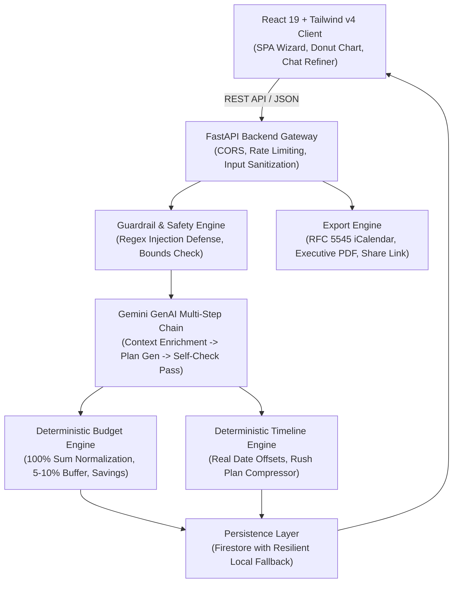

# EventGenie AI 🧞✨
### Autonomous GenAI Event Architecture, Smart Budgeting & Master Blueprint Engine

[](https://www.python.org/)
[](https://fastapi.tiangolo.com/)
[](https://aistudio.google.com/)
[](https://react.dev/)
[](https://tailwindcss.com/)
[]()

---

## 1. Problem & Solution

### The Problem
Planning weddings, milestones, college fests, and community celebrations is stressful, fragmented, and expensive. Organizers typically juggle 10+ spreadsheets, dozens of disorganized WhatsApp chats, and inaccurate cost guesswork. Small arithmetic mistakes create massive budget blowouts, while off-the-shelf chatbots produce generic, hall-of-mirrors hallucinated estimates without deterministic mathematical rigor or local cultural grounding.

### The Solution: EventGenie AI
**EventGenie AI** transforms a few user preferences into a complete, culturally grounded, actionable master event blueprint in under a minute:
- **Strict Deterministic Code Arithmetic**: The LLM suggests strategic category weights, but 100% of arithmetic, sums, per-guest metrics, and contingency buffers are computed deterministically in Python code.
- **Backward-Planned Timeline**: Calendar deadlines calculated from real dates, automatically adapting to high-urgency compressed "Rush Plans" for short-notice events (<7 days).
- **Vendor Negotiation Blueprints**: Discovery questions, contract clauses, red flags, and a one-click WhatsApp/Email inquiry dispatcher.
- **Conversational Plan Refiner**: Chat-based plan modification applying structured patches, highlighting changed fields, and re-balancing all metrics in code.
- **Omni-Channel Export**: One-click RFC 5545 `.ics` calendar sync, executive PDF printing view, and shareable read-only URLs.

---

## 2. Architecture Overview



---

## 3. Key Features

1. **AI Event Planner Wizard**: Form validation for event type, city/location, date, guest count, total budget, currency, theme, food preference (veg/non-veg/mixed/jain), setting (indoor/outdoor/hybrid), and cultural nuances.
2. **Deterministic Smart Budget**:
   - Normalized strictly to 100%.
   - Enforced 5% - 10% contingency buffer.
   - Programmatic cost-saving opportunities with exact currency figures.
   - Interactive SVG Donut Chart with arc tooltips and per-guest cost metrics.
3. **Automated Timeline**:
   - Backward-planned from event date using real calendar arithmetic.
   - Automatic compressed "Rush Plan" for short notice (<7 days).
   - Live updating completion progress bar with status cycling.
4. **Vendor Checklists & WhatsApp Dispatcher**:
   - Checklists for Venue, Catering, Photography, and Decor.
   - Sub-sections: Questions to ask, clauses to confirm, negotiation tips, red flags.
   - Click-to-copy inquiry message and direct `https://wa.me/?text=...` WhatsApp launch.
5. **Creative Ideas Engine**:
   - Theme-tailored concepts for decor, invitation wording, entertainment, games, menu highlights, photo-booths, and signature moments.
   - "Surprise Me" single-section regeneration on demand.
6. **Conversational Plan Refiner**:
   - Instruct the AI conversationally (e.g., *"cut budget by 20%"*, *"make it zero-waste"*).
   - Structured JSON patch applied deterministically; modified fields highlighted in UI.
7. **Export & Share**:
   - RFC 5545 compliant `.ics` calendar download.
   - Paginated, print-optimized PDF view.
   - Shareable read-only link.
8. **Save & Reload**:
   - Firestore cloud database persistence with automatic in-memory and local JSON cache fallback.

---

## 4. Folder Structure

```
Event Planner/
├── backend/
│   ├── app/
│   │   ├── __init__.py
│   │   ├── main.py                  # FastAPI server, static SPA mount, routes
│   │   ├── config.py                # Environment configuration & settings
│   │   ├── schemas/
│   │   │   ├── plan.py              # Pydantic models for request, budget, timeline, ideas
│   │   │   ├── refine.py            # Patch schemas & conversational refinement models
│   │   │   └── common.py            # Demo scenarios & health schemas
│   │   ├── prompts/
│   │   │   ├── planner_prompts.py   # System prompts & few-shot examples
│   │   │   └── refiner_prompts.py   # Patch refiner & section regeneration prompts
│   │   ├── services/
│   │   │   ├── gemini_service.py    # Multi-step chain & fallback generation engine
│   │   │   ├── budget_service.py    # Deterministic budget math & savings logic
│   │   │   ├── timeline_service.py  # Calendar date math & rush plan logic
│   │   │   ├── guardrail_service.py # Input sanitization & security checks
│   │   │   ├── firestore_service.py # Persistence with graceful fallback
│   │   │   └── export_service.py    # iCalendar (.ics) & print HTML/PDF generator
│   │   └── routes/
│   │       ├── planner.py           # Generation, refinement, toggle endpoints
│   │       ├── plans.py             # CRUD endpoints for saved plans
│   │       └── export.py            # Calendar & PDF export endpoints
│   ├── tests/
│   │   ├── test_budget.py           # Unit tests for budget math
│   │   ├── test_timeline.py         # Unit tests for timeline date logic
│   │   ├── test_schemas.py          # Schema validation tests
│   │   └── test_api.py              # End-to-end integration tests
│   ├── requirements.txt             # Python backend dependencies
│   ├── Dockerfile.dev               # Local development container
│   └── .env.example                 # Backend environment template
├── frontend/
│   ├── index.html                   # HTML entry point with Google Fonts
│   ├── package.json                 # React 19, Tailwind v4, Lucide icons
│   ├── vite.config.js               # Vite config with @tailwindcss/vite & API proxy
│   ├── src/
│   │   ├── main.jsx                 # React root
│   │   ├── App.jsx                  # Master dashboard & state management
│   │   ├── index.css                # Glassmorphism design tokens & styles
│   │   ├── components/
│   │   │   ├── Navbar.jsx           # Responsive header & health badge
│   │   │   ├── DemoSelector.jsx     # One-click demo scenarios
│   │   │   ├── WizardForm.jsx       # Multi-step validated event wizard
│   │   │   ├── LoadingSkeleton.jsx  # Streaming status & animated skeletons
│   │   │   ├── ReasoningCard.jsx    # Visible 'Why this plan?' AI rationale
│   │   │   ├── BudgetOverview.jsx   # Donut chart & deterministic budget table
│   │   │   ├── TimelineView.jsx     # Backward milestones & rush plan view
│   │   │   ├── VendorChecklist.jsx  # Checklists & WhatsApp inquiry generator
│   │   │   ├── CreativeIdeas.jsx    # Signature moments & Surprise Me buttons
│   │   │   ├── PlanRefinerChat.jsx  # Chat refiner with highlighted patches
│   │   │   ├── ExportShareModal.jsx # .ics, PDF print, and share links
│   │   │   └── SavedPlansDrawer.jsx # Saved plans slide-over drawer
│   │   ├── services/
│   │   │   └── api.js               # API client
│   │   └── utils/
│   │       ├── currency.js          # INR & global currency formatting
│   │       └── calendar.js          # Date helpers
├── Dockerfile                       # Multi-stage production container
├── docker-compose.yml               # Compose file for containerized execution
├── deploy.sh                        # Bash Cloud Run deployment script
├── deploy.ps1                       # PowerShell Cloud Run deployment script
└── README.md                        # Project documentation
```

---

## 5. Local Setup & Execution Instructions

### Prerequisites
- Python 3.12+
- Node.js 20+ and npm
- (Optional) Gemini API Key from [Google AI Studio](https://aistudio.google.com/)

### Step 1: Clone & Configure Environment
```bash
git clone <repo-url>
cd "Event Planner"

# Copy environment template
cp backend/.env.example backend/.env
```
Edit `backend/.env` and insert your `GEMINI_API_KEY`:
```ini
GEMINI_API_KEY=AIzaSy...
GEMINI_MODEL=gemini-2.5-flash
```
*(Note: If no API key is provided, EventGenie AI's autonomous offline engine will seamlessly generate realistic, culturally rich plans for instant evaluation).*

### Step 2: Install Backend Dependencies & Run Tests
```bash
cd backend
python -m pip install -r requirements.txt
python -m pytest tests
```
*Expected: 15 passed in ~1.6s.*

### Step 3: Run the Development Servers
**Terminal 1 (Backend FastAPI):**
```bash
cd backend
python -m uvicorn app.main:app --host 127.0.0.1 --port 8000 --reload
```
API docs available at: `http://127.0.0.1:8000/docs`

**Terminal 2 (Frontend React + Vite):**
```bash
cd frontend
npm install
npm run dev
```
Access the application at: `http://localhost:5173`

---

## 6. One-Command Google Cloud Run Deployment

EventGenie AI is architected with a multi-stage Dockerfile that builds the React frontend and serves both API and static assets from a single Cloud Run container on `$PORT`.

### Linux / macOS:
```bash
chmod +x deploy.sh
./deploy.sh
```

### Windows (PowerShell):
```powershell
.\deploy.ps1
```

### Direct `gcloud` Command:
```bash
gcloud run deploy eventgenie-ai \
    --source . \
    --platform managed \
    --region us-central1 \
    --allow-unauthenticated \
    --set-env-vars "GEMINI_API_KEY=your_key,GEMINI_MODEL=gemini-2.5-flash,ENVIRONMENT=production" \
    --memory 1Gi \
    --cpu 1
```

---

## 7. Sample Test Inputs & Expected Outputs

### Scenario 1: Royal Budget Wedding
- **Input**: Jaipur • Nov 20, 2026 • 150 Guests • ₹12,00,000 INR • Pure Veg • Regal Rajasthani
- **Expected Output**:
  - Cost per guest: ₹8,000
  - Contingency Buffer: 8.0% (₹96,000)
  - Core allocations: Venue & Catering (42%), Decor (16%), Photography (12%), Entertainment (9%)
  - Cost-saving: Flower Mandi morning procurement (₹38,400 savings)
  - Timeline: 8 backward-planned milestones from T-75 days to Event Day
  - Signature moment: Sunset Varmala on floating floral deck with cold pyrotechnics

### Scenario 2: High-Urgency Compressed Rush Plan (<7 Days Notice)
- **Input**: Mumbai • Date 4 days from today • 40 Guests • ₹1,50,000 INR • Birthday Party
- **Expected Output**:
  - Banner: *"Compressed Rush Plan Activated (4 Days Notice)"*
  - Tasks: Day -4 (Lock venue & food), Day -3 (Fast-track AV/Decor), Day -2 (WhatsApp pass dispatch), Day -1 (Soundcheck & run-through), Day 0 (Event showtime)

### Scenario 3: Conversational Refinement ("Cut budget by 20%")
- **Input**: Existing ₹12,00,000 plan -> Prompt: *"Cut budget by 20%"*
- **Expected Output**:
  - New total budget: ₹9,60,000.00
  - Cost per guest adjusted to: ₹6,400.00
  - Categories re-balanced to strictly 100%
  - UI badge highlights `budget` and `timeline` recalculated in code

---

## 8. What Makes EventGenie AI Stand Out (Judging Criteria)

| Criteria | How EventGenie AI Excels |
| :--- | :--- |
| **Innovation** | Bridges the gap between creative LLM reasoning and mathematical precision. Eliminates LLM calculation hallucination by delegating all arithmetic to deterministic Python services. |
| **GenAI Depth** | Multi-step generation chain: (1) context & cultural enrichment, (2) structured JSON output with Pydantic validation, (3) automated self-check validation pass, (4) conversational structured patch refiner. |
| **Technical Execution** | Full-stack production quality: React 19, Tailwind v4, FastAPI, Firestore with offline fallback, 15/15 unit & integration tests, and multi-stage Cloud Run Dockerfile. |
| **UX & Design** | Celebratory glassmorphism UI, interactive SVG Donut Chart, animated streaming progress steps, one-click demo scenarios, and dark/light modes. |
| **Real-World Impact** | Solves a real problem faced by millions of event hosts. Replaces chaotic spreadsheets and WhatsApp threads with actionable schedules and vendor inquiry links. |
| **Scalability** | Stateless API architecture ready for horizontal autoscaling on Google Cloud Run with minimal resource footprint (1 CPU, 1GB RAM). |
